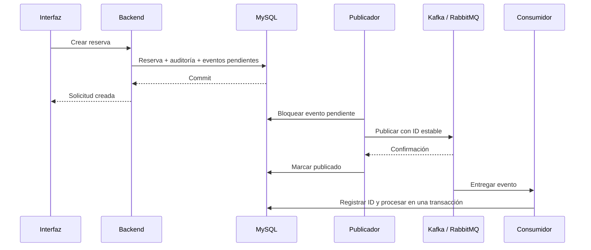

# Paso 5: eventos fiables con outbox e inbox

## Qué fallaba

Enviar directamente a un broker durante una transacción de base de datos no coordina ambos sistemas. Un envío podía fallar después de guardar la reserva, o llegar al broker y después deshacerse la transacción. También se podían entregar mensajes repetidos.

## Cómo queda el flujo

Los productores ahora agregan filas a `outbox_events`. La creación guarda una reserva, su evento de auditoría y tres eventos pendientes dentro de la misma transacción. Si falla guardar cualquiera de esos datos, todo se revierte. No se contacta con el broker durante la transacción de creación.

Un proceso programado consulta hasta 50 eventos disponibles. Cada envío bloquea su propia fila, comprueba que siga pendiente y espera confirmación. Una segunda instancia debe esperar el mismo bloqueo y comprobar nuevamente el estado antes de publicar.

Kafka publica usando el ID como clave y espera el resultado del envío; usa `acks=all` e idempotencia del productor. RabbitMQ utiliza mensajes persistentes, cola durable, confirmaciones correlacionadas y devoluciones por falta de ruta. Una confirmación negativa, un mensaje devuelto o un tiempo agotado mantiene el evento pendiente. Véanse las [confirmaciones de RabbitMQ](https://www.rabbitmq.com/docs/confirms) y su [integración con Spring AMQP](https://docs.spring.io/spring-amqp/reference/amqp/template.html).

Los reintentos tienen espera creciente: 2, 4, 8 segundos, hasta un máximo de 300 segundos. Mantienen el mismo ID y payload. El contador y el siguiente intento se guardan en MySQL, por lo que sobreviven a un reinicio.

## Entregas repetidas

Si el broker confirma y el proceso cae antes de guardar la marca de publicación, el mismo evento se enviará de nuevo. La garantía es entrega al menos una vez, no entrega exactamente una vez.

`InboxService` inserta el par destino/ID en `consumed_events`, cuya clave primaria impide duplicados. Solo ejecuta la acción cuando la inserción es nueva. La inserción y la acción se ejecutan en la misma transacción de base de datos. Si la acción falla, el registro se revierte y una nueva entrega puede intentarla otra vez.

Esta protección cubre las acciones de base de datos dentro de esa transacción. Una futura acción externa, como enviar un correo o cobrar, también necesita una clave de idempotencia propia; no debe asumirse que la transacción JDBC coordina ese servicio.

El consumidor Kafka reintenta errores sin descartar automáticamente el registro. El consumidor RabbitMQ realiza tres intentos totales ante errores de procesamiento y, si se agotan, rechaza sin reencolar para enviar la entrega a cuarentena. Consulta las políticas y alertas del [paso 11](11-rabbitmq-dlq-retencion.md). Los mensajes antiguos sin ID se identifican mediante una huella de su contenido; dos mensajes antiguos con contenido idéntico se consideran la misma entrega.

Los logs de consumidores evitan imprimir el contenido y los datos del huésped. El grupo Kafka puede configurarse mediante `spring.kafka.consumer.group-id`.

## Verificación

Las pruebas comprueban:

- Commit conjunto de reserva, auditoría y tres eventos; reversión total si falla la escritura de un evento.
- Reserva conservada durante una caída de broker, espera de reintento e ID estable.
- Confirmación Rabbit positiva, negativa, sin ruta y ausente; fallo del envío Kafka.
- Procesamiento único por destino y reversión del registro inbox si falla la acción.
- Entrega efectiva de los tres eventos mediante MySQL, Kafka y RabbitMQ reales.

No se publica retrospectivamente una reserva antigua solo por ejecutar las migraciones. El mantenimiento periódico y la retención de outbox/inbox requieren una política según el volumen y la operación del negocio.
