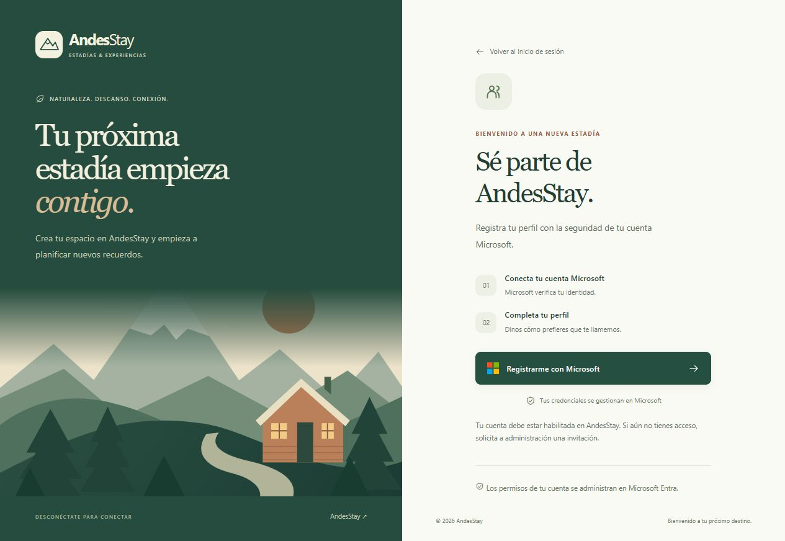

# Paso 8: registro de perfil con Microsoft

> Este documento describe el paso 8. El [paso 9](09-registro-publico.md) reemplaza la asignación manual del acceso de huésped por una regla del backend y prepara el registro público en Entra.

La página de registro está en `http://localhost:5173/register`. Se llega desde “Crear mi perfil en AndesStay” en el inicio de sesión, y desde el nombre de la cuenta en la barra superior.

## Qué pide la rúbrica

El caso establece login corporativo con Azure AD, uso de MSAL, validación de JWT y permisos por rol. No exige implementar contraseñas propias para registrarse. Estos requisitos aparecen en los apartados de identidad, seguridad del frontend y seguridad del backend del documento “Caso 5 - AndesStay(1).docx”.

Este paso conserva ese mecanismo de identidad. Los demás requisitos del caso, como reservas, catálogo, reportes y mensajería, siguen formando parte del proyecto.

## Cómo funciona y por qué

1. La persona abre el registro y selecciona **Registrarme con Microsoft**. MSAL inicia el acceso en Microsoft y conserva `/register` como página de regreso. Esto evita pedir o almacenar contraseñas en AndesStay.
2. Después del acceso, la web obtiene un token de acceso mediante MSAL y consulta el perfil. El BFF y el backend mantienen su validación del JWT y sus reglas de emisor y audiencia.
3. Si todavía no existe un perfil, la persona completa su nombre. La cuenta Microsoft aparece como un campo de solo lectura. El formulario envía únicamente `displayName`.
4. El backend obtiene `tid` y `oid` del JWT validado y los combina como `tenant:object`. Así, la propiedad del perfil depende de la identidad Microsoft, aunque cambie el correo o dos cuentas usen la misma dirección.
5. El backend guarda el nombre, la identidad estable, el correo disponible en los claims firmados y la fecha de registro en MySQL. Si el token no trae correo, este dato queda vacío. No recibe contraseñas, ni toma el propietario o los roles desde el formulario.
6. La página muestra la confirmación y el perfil. En una visita posterior reconoce el registro existente y evita ofrecer otro formulario de alta.

El nombre admite entre 2 y 120 caracteres, se recortan los espacios de los extremos y se rechazan caracteres de control. La restricción única de la base impide dos perfiles para la misma identidad, incluso ante solicitudes simultáneas. Un duplicado responde con HTTP 409 y el frontend vuelve a comprobar el perfil.

## Identidad y permisos

Un JWT válido permite consultar o registrar **el perfil propio**, incluso si todavía no contiene un rol de AndesStay. No permite elegir un rol ni acceder a reservas, catálogo o funciones administrativas.

Los roles `Admin`, `Recepcionista`, `Huesped` y `Auditor` continúan asignándose en Microsoft Entra. Si una cuenta registra su perfil sin un rol, la pantalla explica que administración debe habilitar sus permisos. Las comprobaciones de reservas y de propiedad se mantienen.

La ruta pública muestra la pantalla de bienvenida; las operaciones de la API requieren autenticación:

| Operación | Frontend/BFF | Backend |
| --- | --- | --- |
| Consultar el perfil propio | GET `/api/bff/account/profile` | GET `/api/account/profile` |
| Registrar el perfil propio | POST `/api/bff/account/register` | POST `/api/account/register` |

El BFF usa destinos fijos y reenvía el token ya validado. Ninguna operación recibe un identificador que permita consultar o modificar el perfil de otra persona.

## Alcance de la cuenta Microsoft

Este registro crea **un perfil de AndesStay vinculado a una identidad Microsoft**, no una cuenta nueva en el directorio de Entra. Una persona externa necesita una invitación o un flujo de registro habilitado por administración en ese directorio.

Microsoft documenta que el registro externo por autoservicio requiere configurar el tenant y un flujo para la aplicación: [flujos de registro por autoservicio de Microsoft Entra](https://learn.microsoft.com/en-us/entra/external-id/self-service-sign-up-user-flow). No se modificó esa configuración externa desde el código.

## Archivos principales

- Frontend: `pages/Register.jsx`, `pages/Login.jsx`, `components/AuthLayout.jsx`, `components/MicrosoftButton.jsx`, `App.jsx`, `components/Navbar.jsx` y los estilos de registro.
- Backend: entidad, repositorio, servicio, controlador y manejo de errores de `UserProfile`.
- Migración Flyway: `V5__user_profiles.sql`. Añade una tabla independiente; no cambia reservas ni perfiles anteriores.
- BFF y backend: reglas explícitas de autenticación para las dos operaciones del perfil.
- Respaldo previo: `backup/code-step-08-registration/`.

## Verificación del 4 de octubre de 2026

- Frontend: 24 pruebas aprobadas, ESLint y construcción de producción.
- Backend: 147 pruebas ejecutadas y aprobadas; las 3 pruebas específicas del entorno externo se omiten en esta ejecución.
- BFF: 43 pruebas aprobadas.
- MySQL y brokers reales: 34 pruebas aprobadas. La migración se verificó sobre una base nueva y una copia del respaldo. También se comprobaron la unicidad del perfil y la precisión de su fecha.
- Seguridad: acceso anónimo o token inválido rechazado; correo, propietario y roles enviados por el cliente no sustituyen los del token; separación de perfiles por usuario y tenant; cuentas sin rol no obtienen acceso a operaciones restringidas.
- Navegador: pantalla pública, formulario, confirmación, cuenta sin rol y adaptación a 390 y 320 píxeles. Los estados autenticados se revisaron con respuestas ficticias en una vista aislada dentro de `.validation/`, que no forma parte de la aplicación de producción.

La comprobación con una cuenta Microsoft real debe completarla su titular. Las pruebas automatizadas y la vista aislada no sustituyen esa comprobación del tenant.

