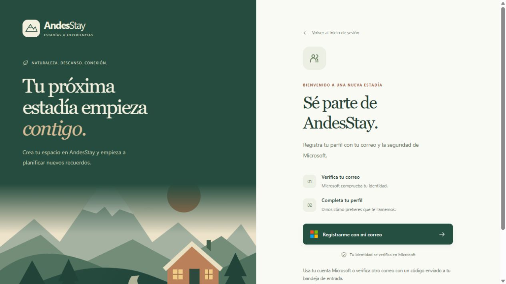
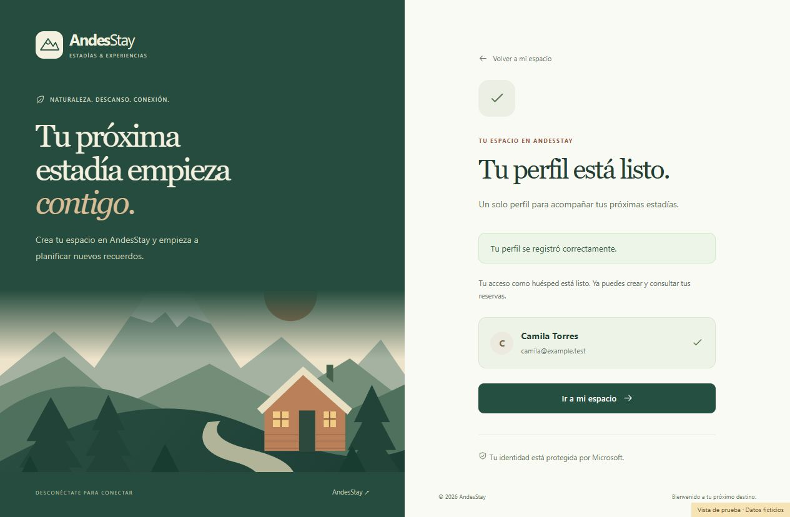
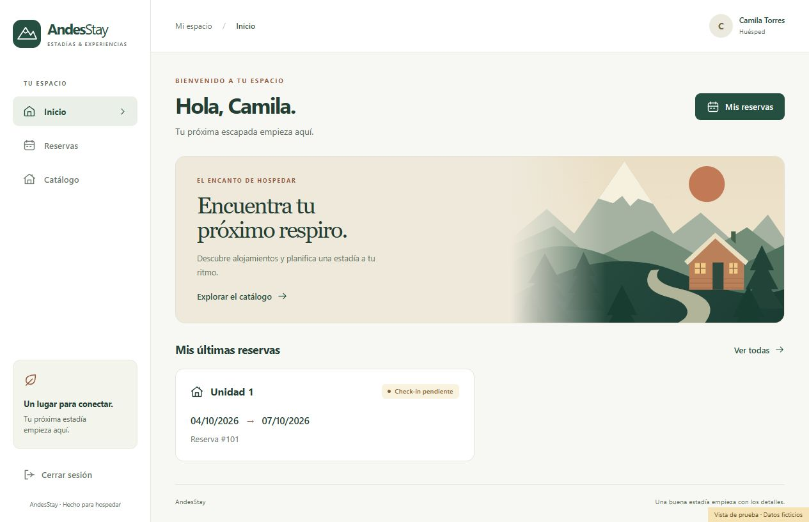

# Paso 9: registro público con Microsoft

El código de registro público está implementado y actualizado en el entorno local. **La configuración del directorio Microsoft Entra quedó guardada el 4 de octubre de 2026, tras la confirmación del usuario.** Se verificó el rol de Administrador global en el directorio correcto. Falta completar una prueba con una cuenta externa real para confirmar el alta de principio a fin.

## Qué cambia para el cliente

1. El flujo de Entra configurado permite que una cuenta Microsoft personal o institucional cree automáticamente su identidad de invitado mediante un flujo de registro asociado a AndesStay.
2. Microsoft autentica a la persona y emite el token de acceso. AndesStay continúa usando MSAL y valida la firma, vigencia, emisor y audiencia del JWT.
3. La persona completa su nombre en `/register`. El servidor guarda el perfil propio y confirma el permiso `Huesped`.
4. Puede entrar inmediatamente a su espacio, consultar alojamientos y crear y consultar sus propias reservas. No necesita cerrar sesión ni esperar una asignación manual.

«Invitado» es el tipo de identidad externa de Entra; «Huesped» es el permiso de AndesStay. Son conceptos distintos.

## Por qué se implementó así

El JWT sigue siendo el original de Microsoft. No se crea un token alternativo ni se cambia el emisor para aceptar cualquier directorio. El backend calcula una autoridad de aplicación `ROLE_Huesped` cuando se cumplen **todas** estas condiciones:

- El JWT ya superó la validación del recurso protegido.
- Contiene el permiso delegado exacto `access_as_user` en `scp`.
- Contiene `tid` y `oid` de tipo texto, no vacíos, cuya clave combinada cabe en el campo de identidad.
- No tiene roles asignados: el claim está ausente o es una colección vacía.
- Existe un perfil para esa misma identidad `tid:oid`.

Esto separa la verificación de identidad de Microsoft del permiso básico de cliente. Un token de aplicación sin `scp`, un perfil ajeno o un rol desconocido no recibe acceso automático. Un Auditor conserva sus permisos de auditoría sin convertirse en huésped.

Los permisos `Admin`, `Recepcionista` y `Auditor` se obtienen exclusivamente del claim firmado de roles asignados en Entra. Enviar esos roles, un propietario o un correo diferente en el formulario no modifica los permisos ni la identidad guardada.

El BFF valida el JWT y, para una identidad candidata al acceso automático, consulta el perfil en una ruta fija del backend. Solo concede acceso de huésped si la respuesta confirma el registro y ese permiso. Un error o una respuesta inválida no concede acceso. Este control añade una consulta interna por solicitud de esas cuentas; evita mantener una caché de permisos que pueda quedar desactualizada.

El frontend usa los permisos efectivos devueltos por el servidor. Así, una cuenta cuyo ID token no contiene roles ve inmediatamente su navegación de huésped. Si falla la comprobación del perfil, la página privada ofrece reintentar sin cargar información restringida.

Las reservas conservan su control de propiedad en el backend. Un cliente no puede consultar reservas ajenas, cambiar estados, gestionar el catálogo, abrir reportes o acceder a auditoría.

## Configuración de Entra aplicada

Directorio: **Cristobal**, `2fec6e6e-3e74-4c31-82ae-8cc3d1974636`.

Aplicación: **AndesStay**, `3e5c6423-0b9e-4125-b4ad-1b916c5c2f64`.

Se guardaron y verificaron en el portal los cambios autorizados:

| Ajuste | Estado comprobado |
| --- | --- |
| Registro de autoservicio para invitados mediante flujos | Sí |
| Flujo de registro e inicio de sesión | `B2X_1_AndesStayPublico` |
| Proveedores de identidad | Microsoft Entra ID, Cuenta Microsoft y código de un solo uso por correo |
| Atributo recogido por Entra | Dirección de correo electrónico |
| Aplicaciones asociadas al flujo | Solo AndesStay, con el ID indicado arriba |
| Cliente SPA preautorizado | AndesStay, con el mismo ID |
| Scope preautorizado | Solo `access_as_user` de nuestra API |

El nombre preferido se completa en AndesStay después de la autenticación. En la configuración inicial se habilitaron Microsoft Entra ID y Cuenta Microsoft; tras una segunda confirmación del usuario se añadió el código de un solo uso por correo.

Antes del cambio, el registro de autoservicio estaba en No y no había flujos ni clientes preautorizados. AndesStay ya estaba habilitada para iniciar sesión y **¿Asignación requerida?** estaba en **No**; ambos valores se conservaron. La aplicación mantiene sus controles de permisos.

El procedimiento oficial consiste en habilitar el registro de invitados, crear el flujo y asociar la aplicación. Requiere al menos el rol de directorio Administrador de usuarios; en esta sesión se verificó Administrador global. Fuentes: [configuración de flujos B2B](https://learn.microsoft.com/en-us/entra/external-id/self-service-sign-up-user-flow) y [proveedor Cuenta Microsoft](https://learn.microsoft.com/en-us/entra/external-id/microsoft-account).

La aplicación empresarial permite iniciar sesión sin asignación individual; si se activara **¿Se requiere asignación?**, una cuenta sin asignación podría recibir AADSTS50105. El backend sigue exigiendo un perfil propio antes de conceder acceso automático de huésped. Fuente: [efecto de la asignación requerida](https://learn.microsoft.com/en-us/troubleshoot/entra/entra-id/app-integration/error-code-AADSTS50105-user-not-assigned-role).

La URI SPA sigue siendo `http://localhost:5173` y el scope sigue siendo `api://3e5c6423-0b9e-4125-b4ad-1b916c5c2f64/access_as_user`. La preautorización guardada evita que ese cliente solicite consentimiento individual para el scope seleccionado. Se conservaron los permisos existentes de Microsoft Graph y no se concedió consentimiento administrativo adicional. Fuente: [preautorizar un cliente para una API](https://learn.microsoft.com/en-us/entra/identity-platform/quickstart-configure-app-expose-web-apis).

Las políticas del directorio y de la institución de origen todavía pueden exigir MFA o limitar el acceso. El registro automático elimina la invitación individual; conserva las comprobaciones de Microsoft.

## Ampliación a correos de otros proveedores

El 4 de octubre de 2026 se comprobó que el proveedor integrado de código de un solo uso por correo ya estaba habilitado en el directorio Cristobal. Tras la confirmación del usuario, **se añadió y guardó en el flujo `B2X_1_AndesStayPublico`**. Se verificó en el portal que están seleccionados los tres proveedores y que no hay cambios pendientes.

Esta opción permite verificar correos sin cuenta de Microsoft Entra, Cuenta Microsoft ni otro proveedor federado, enviándoles un código. Si un correo ya tiene una identidad Microsoft, se autentica con esa identidad. No se configura un botón de Google ni se solicitan contraseñas a AndesStay. Fuente: [autenticación por código de correo en Microsoft Entra](https://learn.microsoft.com/en-us/entra/external-id/one-time-passcode).

Se adaptaron los textos de login y registro para hablar de correo verificado y explicar ambas formas de entrada. La API, la validación del JWT y el cálculo de permisos se mantienen. Después se corrigió la solicitud MSAL de registro para iniciar explícitamente el alta con `prompt=create`, como se detalla a continuación. El flujo continúa asociado únicamente a AndesStay. El frontend local fue reconstruido con los nuevos textos.

Para comprobar el alta completa, una persona debe usar un correo externo nuevo que no esté vinculado a Microsoft, recuperar el código en su propia bandeja, completar la verificación en Microsoft y guardar su perfil en AndesStay. Después debe poder consultar el catálogo y crear y consultar sus propias reservas. Esta prueba real sigue pendiente.

Para esta ampliación se volvieron a ejecutar y aprobar las 29 pruebas del frontend, ESLint y la compilación. También se revisaron las páginas públicas sin errores de consola. No se modificó la lógica de autenticación ni autorización del servidor.

Respaldo previo de los archivos modificados: `backup/code-step-10-email-registration/`.

## Corrección del inicio del registro público

La prueba con una cuenta externa mostró que el botón de registro seguía abriendo el selector de cuentas y rechazaba una identidad que todavía no existía en Cristobal. El proveedor de correo estaba habilitado, pero el frontend enviaba `prompt=select_account`, que solicita iniciar sesión con una identidad existente.

Se cambió únicamente la solicitud de `Register.jsx` a `prompt=create`. Microsoft documenta que este valor inicia el registro de identidades externas. El inicio de sesión normal conserva su solicitud para las cuentas existentes. No se añade la cuenta manualmente ni se modifica el directorio para resolver este error. Fuente: [comportamiento de los prompts en Microsoft](https://learn.microsoft.com/en-us/entra/identity-platform/scenario-desktop-acquire-token-interactive).

El backend conserva la firma, el emisor, la audiencia y los permisos del JWT. La prueba real de la web reconstruida confirmó:

- La página de Microsoft ahora muestra **Crear cuenta**, con una opción de registro por dirección de correo electrónico.
- La opción de correo abre el formulario de dirección para iniciar el alta.
- La solicitud contiene `prompt=create`, el mismo ID de AndesStay y el mismo scope `access_as_user`.
- Se conserva PKCE con `code_challenge_method=S256`.
- Las 29 pruebas del frontend, ESLint y la construcción pasaron; la prueba de registro ahora exige explícitamente `prompt=create`.
- El frontend de Docker quedó actualizado y saludable.

Falta completar la verificación de la cuenta externa y su perfil. La pantalla de alta está comprobada; esta comprobación no demuestra todavía el alta completa.

Respaldo previo: `backup/code-step-11-signup-prompt/`.

## Verificación realizada el 4 de octubre de 2026

| Comprobación | Resultado |
| --- | --- |
| Backend | 157 pruebas aprobadas; 3 externas omitidas |
| BFF | 54 pruebas aprobadas |
| Frontend | 29 pruebas aprobadas |
| ESLint y construcción de React | Aprobados |
| Docker | 6 servicios saludables |
| Página real `/register` | HTTP 200, sin errores de consola |
| API de perfil y registro sin autenticación; registro con token inválido | HTTP 401 |
| Prueba visual de huésped nuevo | Registro, navegación y reservas revisados |
| Confirmación a 390 píxeles | Sin desbordamiento horizontal |
| Entra: autoservicio, proveedores y aplicación asociada | Guardados y verificados en el portal |
| Entra: cliente preautorizado para un scope | Guardado y verificado en el portal |
| Botón real «Registrarme con mi correo» | Abre «Crear cuenta» con `prompt=create`, scope esperado y PKCE S256 |
| Alta completa de una nueva cuenta externa | Pendiente de autenticación por el usuario |

El backend se verificó con su suite completa; después se añadió y aprobó una prueba de rechazo de tokens sin permiso delegado, junto con las otras siete pruebas del controlador de perfiles. El total anterior combina ambos resultados.

Una prueba de integración con JPA verifica que **el mismo JWT** primero no puede crear reservas, después registra su perfil y a continuación crea y consulta solo sus propias reservas. También verifica que no obtiene permisos de recepción. Las pruebas del BFF rechazan perfiles ausentes o inválidos y comprueban que una respuesta con roles adicionales nunca concede Admin.

Los estados autenticados de las capturas utilizan una vista aislada con **datos ficticios**, fuera del código de producción. Entra ya está configurado y el botón real de registro abre Microsoft. Falta completar la autenticación de una cuenta externa nueva y comprobar su perfil y sus reservas; las capturas ficticias no sustituyen esa prueba.

## Archivos y respaldo

- Backend: `service/AccountRoles.java`, `service/UserProfileService.java`, `repository/UserProfileRepository.java` y `config/SecurityConfig.java`.
- BFF: `config/SecurityConfig.java` y `service/BffReservationService.java`.
- Frontend: `components/AccountProvider.jsx`, `auth/AccountContext.js`, `App.jsx`, `hooks/useApi.js`, `components/Navbar.jsx`, `pages/Register.jsx` y `pages/Login.jsx`.
- Pruebas nuevas: acceso de huésped, autorización del perfil, proxy BFF, propiedad de reservas y flujo del frontend.
- Respaldo previo: `backup/code-step-09-public-registration/`.
- Se reutiliza `user_profiles` de la migración V5. No se añadió una migración ni se modificó el respaldo SQL.

Las capturas de administración de Entra se conservan localmente y se excluyen de Git; las vistas con datos ficticios sí se incluyen.
