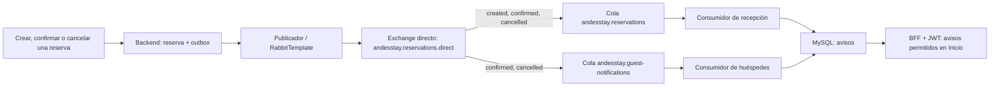

# Paso 10: RabbitMQ aplicado a las reservas de AndesStay

## Qué practicamos de las guías

Las guías enseñan dos ideas: publicar un mensaje en una cola y distribuir un mensaje mediante un exchange, bindings y routing keys. En AndesStay las usamos para generar avisos cuando cambia una reserva.

Antes, RabbitMQ recibía solamente la creación de una reserva en una cola y el consumidor registraba la entrega en un log. Ahora hay tres tipos de evento y dos consumidores con un efecto visible: guardar avisos que se consultan desde Inicio.

| Concepto de la guía | Aplicación en AndesStay |
| --- | --- |
| Productor | `ReservationProducer` prepara el evento de una reserva real. |
| Publicación con `RabbitTemplate` | `BrokerGateway` publica los eventos confirmados en la base de datos. |
| Exchange directo | `andesstay.reservations.direct`. |
| Binding | Enlace de una cola al exchange para una clave concreta. |
| Routing key | `reservation.created`, `reservation.confirmed` o `reservation.cancelled`. |
| Cola general | `andesstay.reservations`, utilizada por recepción. Se conserva la cola existente. |
| Cola específica | `andesstay.guest-notifications`, utilizada para avisos a huéspedes. |
| Consumidor con `@RabbitListener` | `ReceptionNotificationConsumer` y `GuestNotificationConsumer`, en `messaging/notifications` desde el [paso 13](13-consumidores-por-dominio.md). |
| Comprobación desde React | Crear o cambiar una reserva y consultar sus avisos en Inicio. |

La segunda guía implementa un **DirectExchange**: compara la clave completa, sin comodines. Aunque su conclusión menciona topics, el código mostrado corresponde a enrutamiento directo. La referencia oficial de [routing con Spring AMQP](https://www.rabbitmq.com/tutorials/tutorial-four-spring-amqp) explica este mismo comportamiento.

## Quién recibe cada evento

| Acción real | Tipo del evento | Routing key | Recepción | Huésped |
| --- | --- | --- | --- | --- |
| Crear solicitud | `RESERVATION_CREATED` | `reservation.created` | Sí | Sin aviso de creación |
| Confirmar reserva | `RESERVATION_CONFIRMED` | `reservation.confirmed` | Sí | Sí, cuando tiene cuenta asignada |
| Cancelar reserva | `RESERVATION_CANCELLED` | `reservation.cancelled` | Sí | Sí, cuando tiene cuenta asignada |



Las etiquetas abreviadas del diagrama representan las claves completas de la tabla. Un exchange puede copiar la misma publicación a varias colas enlazadas a la misma clave. Por eso confirmar publica una sola vez y produce una copia para cada consumidor.

Dos consumidores escuchando una sola cola se repartirían el trabajo: uno podría recibir la confirmación y el otro no. Aquí necesitamos dos efectos independientes, por lo que cada consumidor tiene su propia cola.

La cola de huéspedes es compartida por el servicio. No se crea una cola por persona ni se permite a React conectarse directamente al broker. El consumidor guarda el destinatario y la API filtra los avisos de la cuenta autenticada.

## Qué cambiamos y por qué

### 1. Topología durable y claves del negocio

`RabbitMQConfig` declara el exchange directo, las dos colas durables y cinco bindings. Las claves describen acciones de reservas y están definidas en el servidor.

`ReservationEventType` relaciona el tipo del evento con su clave y estado. `BrokerGateway` toma la clave del tipo guardado en outbox; el navegador no puede elegir una clave, una cola ni un destinatario. Un tipo desconocido falla la publicación y mantiene pendiente el evento.

Se conservan los mensajes persistentes, las confirmaciones correlacionadas y `mandatory`. Si no hay ruta, una confirmación es negativa o se agota la espera, outbox vuelve a intentarlo con el mismo ID. La confirmación del publicador verifica la aceptación por el broker; el consumidor confirma su entrega después del procesamiento.

### 2. Eventos dentro de la transacción de reserva

`ReservationProducer` sigue preparando eventos en outbox. `ReservationService.updateStatus` ahora prepara también los eventos de confirmación y cancelación.

Esto evita guardar el cambio de estado sin su evento si falla la escritura en MySQL. El broker se contacta después del commit, mediante el publicador existente. Los otros estados del ciclo de estadía conservan su auditoría y no producen estos avisos.

El evento contiene ID de reserva, unidad, fechas, estado y, cuando existe, la identidad propietaria y si tiene un huésped asignado. No incluye nombres, correos ni tokens. La identidad representa la asignación al momento del evento; asignar una cuenta después no reenvía automáticamente avisos anteriores.

### 3. Dos efectos, dos controles de duplicados

`ReceptionNotificationConsumer.receive` guarda el aviso de recepción. `GuestNotificationConsumer.receive` guarda el aviso del huésped cuando corresponde. Desde el [paso 13](13-consumidores-por-dominio.md), cada entrada tiene su propia clase dentro del dominio de notificaciones.

Sus identificadores de consumidor en inbox son distintos:

- `RABBITMQ`: recepción.
- `RABBITMQ_GUEST`: huésped.

Si compartieran el identificador, el segundo consumidor podría confundir su primera copia con un duplicado. Cada efecto se guarda junto con su recibo inbox en una transacción. Si falla el procesamiento, ambos se revierten y la entrega puede reintentarse.

Esto produce un solo aviso por evento y consumidor aunque RabbitMQ repita la entrega. La garantía de transporte continúa siendo entrega al menos una vez.

### 4. Avisos persistentes y acceso por JWT

La migración nueva `V6__reservation_notifications.sql` crea la tabla de avisos e índices para consultar por público, destinatario y fecha. No modifica las reservas ni el respaldo SQL existente.

`ReservationNotificationService` transforma el evento en un aviso y consulta:

- Para Admin o Recepcionista: los avisos de recepción.
- Para Huesped: solamente los avisos cuyo destinatario coincide con `tid:oid` de su JWT.
- Para Auditor: acceso denegado.

Las reservas creadas por recepción no convierten al empleado creador en huésped. Solo se guarda un aviso de huésped si `guestAssigned` es verdadero y la identidad es válida.

La respuesta utiliza `ReservationNotificationResponse`, que no expone el destinatario interno. Se devuelve el ID del aviso, reserva, unidad, estado, título y fecha UTC.

Los avisos se ordenan por **fecha del evento**, del más reciente al más antiguo, y por ID para resolver fechas iguales. La prueba con el broker real mostró que la entrega puede llegar en otro orden. La lista refleja cuándo ocurrió el cambio, con independencia del orden de recepción.

### 5. Un apartado en Inicio

`ReservationNotifications.jsx` se integra en Dashboard:

- El personal ve **Actividad de reservas**.
- El huésped ve **Mis avisos**.
- Se muestran cinco por página, con estado y fecha en `America/Santiago`.
- **Actualizar avisos** vuelve a consultar después de una acción.
- Un fallo de consulta muestra un error y permite reintentar.
- El apartado conserva los colores, componentes y adaptación móvil del frontend.

El recorrido de lectura es `GET /api/bff/notifications?page=0&size=5` hacia `GET /api/notifications`. Backend y BFF exigen un JWT válido y aplican los roles existentes. El tamaño máximo es 100. No hay un endpoint público para enviar mensajes de prueba.

Los avisos son internos de AndesStay. Esta implementación no envía correo ni cambia el registro con Microsoft.

## Compatibilidad

Los eventos anteriores `RESERVATION_CREATED` en outbox utilizan ahora la clave de creación. Los mensajes JSON de creación ya presentes en la cola siguen generando un aviso de recepción, aunque no incluyan identidad.

El texto plano que enviaba el productor original, con el prefijo `Reserva creada: `, se registra y deduplica en inbox sin inventar un aviso a partir del nombre del huésped. Otros sobres JSON antiguos sin un tipo compatible también se registran sin crear un aviso.

Los eventos ya consumidos no se reproducen automáticamente. Por eso la lista puede comenzar vacía hasta que se cree, confirme o cancele una reserva después de activar este cambio.

También se corrigió el wrapper Maven en los cuatro módulos: el script de Windows intentaba indexar un destino de enlace inexistente cuando `.m2` era una carpeta normal. Ahora comprueba si existe un destino antes de usarlo.

## Cómo demostrarlo en la aplicación

1. Recarga AndesStay en [localhost:5173](http://localhost:5173).
2. Inicia sesión con una cuenta de huésped y crea una solicitud desde Reservas.
3. En otra sesión de navegador, entra con Recepcionista o Admin. Ve a Inicio y pulsa **Actualizar avisos**: aparece la solicitud recibida.
4. Desde Reservas, confirma esa solicitud. Si la creó recepción, asigna primero la cuenta del huésped usando el procedimiento existente.
5. Actualiza los avisos de ambas sesiones: recepción y huésped ven la confirmación.
6. Cancela la misma reserva y actualiza de nuevo: ambos ven la cancelación.
7. Con otra cuenta de huésped, comprueba que no aparecen los avisos de esa reserva.

Puede haber unos segundos entre guardar la reserva y ver su aviso, porque el publicador y el consumidor trabajan de forma asíncrona. En condiciones normales, basta actualizar después de ese intervalo.

En [RabbitMQ Management](http://localhost:15672), utiliza las credenciales locales de `.env` y revisa **Exchanges > andesstay.reservations.direct > Bindings**. Deben aparecer cinco enlaces hacia las dos colas. En **Queues** puedes observar los consumidores y la actividad. Una cola con cero mensajes pendientes puede estar funcionando correctamente: sus mensajes ya fueron procesados y sus avisos permanecen en MySQL.

## Pruebas y evidencia

Verificación del 5 de octubre de 2026:

| Comprobación | Resultado |
| --- | --- |
| Backend | 174 aprobadas; 3 específicas del entorno externo omitidas |
| BFF | 58 aprobadas |
| Frontend | 32 aprobadas, ESLint y build correctos |
| Kafka Admin y Rabbit Admin | 2 aprobadas |
| MySQL + brokers reales | 34 aprobadas |
| Docker | 6 servicios saludables |
| Diseño | Recepción y huésped revisados; móvil sin desbordamiento horizontal |

Las pruebas nuevas comprueban los avisos de acciones reales, las tres claves, los dos consumidores, duplicados, reversión conjunta de aviso/inbox, reversión de estado si falla outbox, privacidad entre cuentas y tenants, fechas fuera de orden, compatibilidad con mensajes anteriores y bloqueo de publicaciones manuales.

`RealBrokerIntegrationTests` crea una reserva con MySQL y prueba crear, confirmar y cancelar usando RabbitMQ y Kafka reales. Comprueba **tres avisos de recepción, dos del huésped y cero para otra cuenta**. Verifica que la cola de huéspedes no recibe creación y que `mandatory` devuelve una clave sin binding.

Las pruebas RabbitMQ usan un exchange y colas con prefijo aleatorio `andesstay.verify.`, que se eliminan al terminar. Ya no es necesario detener el backend local ni consumir su cola durante la prueba. El script sigue utilizando y eliminando tres esquemas MySQL temporales, verifica las huellas de los datos originales y mantiene intacto `backup/andesstay.sql`.

Para repetir:

```powershell
.\scripts\test-local.cmd
.\scripts\test-mysql.cmd
```

Los logs están en `.validation/step12-backend.log`, `step12-bff.log`, `step12-frontend-*.log`, `mysql-tests.log` y `step12-docker.log`. El informe de conservación está en `.validation/mysql-migrations.json`.

Las capturas `.validation/avisos-huesped.png`, `avisos-huesped-mobile.png` y `avisos-recepcion.png` corresponden a una vista de prueba con datos ficticios, marcada en pantalla. La verificación de entrega real se realizó separadamente mediante las pruebas de brokers.

El respaldo previo del código está en `backup/code-step-12-rabbit-routing/`.
