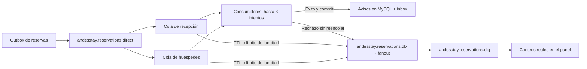
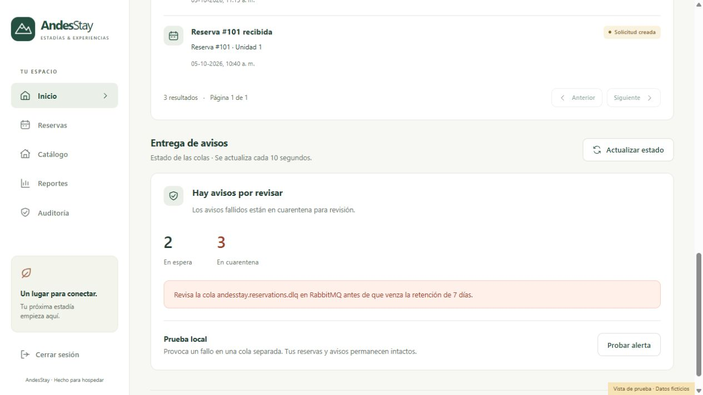
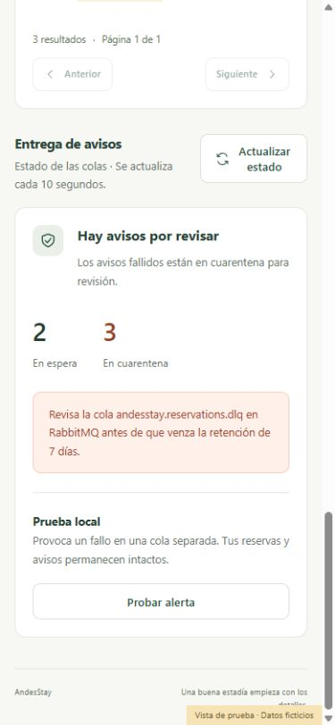

# Paso 11: mensajes fallidos, retención y alertas

Adaptación de la guía «2.2.3 DLX DLQ, políticas de retención y alertas» al flujo de reservas de AndesStay. La guía sirve como referencia pedagógica; el ejemplo de pedidos se reemplaza por la entrega de nuestros avisos.

## Qué cambia y por qué

Antes, un error permanente de un consumidor RabbitMQ podía provocar entregas repetidas indefinidamente. Desde el [paso 14](14-ack-manual-y-clasificacion-de-errores.md), los permanentes se rechazan inmediatamente y los temporales o no clasificados tienen **hasta tres intentos en total**: el inicial y dos reintentos, con esperas de 1 y 2 segundos. Si todos fallan, el backend rechaza sin reencolar y RabbitMQ envía el mensaje al exchange de mensajes fallidos (DLX), que lo enruta a la cola de cuarentena (DLQ).

Un fallo transitorio puede resolverse en esos intentos. Un fallo permanente queda separado y permite seguir procesando otros avisos. Esto no cambia el estado de la reserva: los consumidores procesan avisos y la reserva ya fue guardada junto con su outbox.

El DLX es fanout: todas las entregas fallidas llegan a una DLQ común. RabbitMQ agrega la cabecera `x-death`, que permite identificar la cola original y el motivo, como `rejected`, `expired` o `maxlen`. Una misma reserva puede tener una copia para recepción y otra para el huésped; el conteo de la DLQ representa mensajes, no reservas únicas.

Desde el [paso 14](14-ack-manual-y-clasificacion-de-errores.md), cada listener usa ACK manual y un handler compartido confirma después del commit. El handler reintenta únicamente el procesamiento, clasifica los permanentes y rechaza sin reencolar al agotar el presupuesto. ACK/NACK quedan fuera del callback de reintento, con prefetch 1. La transacción de inbox y del aviso se revierte en cada fallo; si el procesamiento se repite después de un éxito, el ID evita crear otro aviso.

La **DLQ real no tiene un consumidor automático**. Consumirla solo para imprimir un log vaciaría la cuarentena antes de que alguien pudiera revisarla.

## Retención aplicada

| Colas | Tiempo máximo | Límite | Al vencer o superar el límite |
| --- | --- | --- | --- |
| `andesstay.reservations` y `andesstay.guest-notifications` | 24 horas | 10.000 mensajes por cola | Se envían al DLX/DLQ |
| `andesstay.reservations.dlq` | 7 días | Sin límite adicional en esta implementación | Se eliminan los mensajes vencidos |
| `andesstay.delivery-demo` | 10 segundos | 10 mensajes | Se envían a la cuarentena de prueba |
| `andesstay.delivery-demo.dlq` | 60 segundos | Sin límite adicional | Se eliminan los mensajes de prueba vencidos |

Las 24 horas permiten una interrupción del backend más larga que los 30 segundos del ejemplo. Los 7 días dan tiempo para investigar y contienen el crecimiento por antigüedad. **Al vencer la retención se descarta el mensaje; no existe un archivo permanente ni una recuperación automática.** Estos valores deben revisarse según el volumen y la operación del negocio.

La retención afecta a los mensajes en RabbitMQ, no a las reservas, el historial de avisos o las tablas outbox/inbox. Esas tablas necesitan una política propia.

Las colas existentes reciben TTL, límite y DLX mediante **políticas del broker**, recomendadas por [RabbitMQ](https://www.rabbitmq.com/docs/dlx). Así no se cambian sus argumentos de declaración, lo que exigiría recrearlas y podría causar `PRECONDITION_FAILED`. La [documentación de TTL](https://www.rabbitmq.com/docs/ttl) explica la caducidad de mensajes.

Desde el [paso 12](12-topologia-rabbitmq-centralizada.md), `config/rabbit-topology.properties` es la fuente de nombres y límites. El arranque genera `.validation/rabbitmq-definitions.json` con las dos políticas, el DLX fanout, la DLQ y su binding. El trabajo Docker `rabbit-setup` importa esas definiciones después de que RabbitMQ esté saludable y antes de iniciar el backend. Al terminar aparece como **Exited (0)**; es un trabajo de configuración y no un servicio que deba permanecer activo. Se conservan el usuario, sus permisos y el volumen existente.

## Alertas en AndesStay

El inicio de administración y recepción incluye **Entrega de avisos**:

- Consulta el broker cada 10 segundos y permite actualizar manualmente.
- “En espera” cuenta mensajes listos para entregar en las dos colas. La consulta AMQP pasiva no incluye los que ya están en procesamiento ni los pendientes de publicar en outbox.
- “En cuarentena” cuenta mensajes de la DLQ real.
- Si hay mensajes fallidos, muestra una alerta para revisar la DLQ.
- Si una cola tiene cero consumidores, avisa de una pausa de entrega.
- Si faltan colas o no responde RabbitMQ, indica “Estado sin verificar”. Devuelve conteos nulos; no presenta la desconexión como un cero saludable.
- Son lecturas sucesivas del broker; no constituyen una instantánea atómica.

La guía usa resultados aleatorios en React y un estado fijo de conexión. Aquí los conteos proceden del broker. La alerta es visual en la aplicación; no se enviaron correos ni se configuró un servicio externo de notificaciones.

`GET /api/bff/messaging/status` y su equivalente del backend admiten únicamente Admin y Recepcionista. Huésped y Auditor reciben 403. La respuesta no incluye cuerpos de mensajes, nombres, identidades de huéspedes ni credenciales. El BFF reenvía el JWT validado al backend, que vuelve a comprobar permisos.

Vista de prueba con datos ficticios, utilizada para revisar escritorio y móvil:

## Cómo probarlo desde la aplicación

1. Recarga `http://localhost:5173/dashboard` e inicia sesión con un rol Admin.
2. Baja hasta **Entrega de avisos**.
3. Pulsa **Probar alerta** una vez.
4. El backend publica un mensaje persistente en una cola de demostración separada, espera la confirmación del broker y devuelve 202.
5. Su consumidor falla de forma controlada en los tres intentos. Aproximadamente 3 segundos después se mueve a `andesstay.delivery-demo.dlq`.
6. Al siguiente refresco del panel aparece **Prueba local: 1 mensaje(s) en cuarentena**. También puedes pulsar **Actualizar estado**.
7. Transcurridos unos 60 segundos desde su llegada a esa DLQ, vence la retención. El siguiente refresco elimina la alerta de prueba.

Esta prueba no crea, modifica ni cancela reservas; no escribe avisos ni inbox, y no contamina la DLQ real. La alerta de prueba y el contador real están separados.

La opción solo está habilitada expresamente en Docker local mediante `MESSAGING_DEMO_ENABLED=true`. Por defecto está deshabilitada; el backend devuelve 404 en la ruta de prueba y el panel la oculta. El botón de publicación es exclusivo de Admin, incluso cuando la demostración está habilitada.

Para inspeccionar cabeceras, abre `http://localhost:15672` con el usuario local configurado en `.env`, entra a **Queues and Streams** y selecciona la DLQ de prueba. “Get messages” puede consumir o reencolar según la opción elegida: para la demostración de retención basta observar el contador sin extraer mensajes. No publiques fallos deliberados en las colas reales.

## Archivos que implementan el cambio

| Archivo | Responsabilidad |
| --- | --- |
| Backend: `config/RabbitMQConfig.java` | DLX fanout y DLQ durable reales |
| Backend: `config/RabbitDeliveryConfig.java` | Recuperación final: rechazar sin reencolar y log sin cuerpo del mensaje |
| Backend: `resources/rabbit-delivery.properties` | Reintentos, ACK, prefetch y tiempos; compartidos por aplicación y pruebas |
| Backend: `service/MessagingStatusService.java` | Lectura real y estado desconocido ante fallos |
| Backend: `config/RabbitDemoConfig.java`, `service/MessagingDemoService.java`, `messaging/demo/DeliveryDemoConsumer.java` | Topología, publicación y consumo de la demo, separados desde el [paso 13](13-consumidores-por-dominio.md) |
| Backend: `controller/MessagingController.java`, `dto/MessagingStatusResponse.java` | API de estado y prueba |
| Backend y BFF: `config/SecurityConfig.java` | Permisos según método y ruta |
| BFF: `BffController.java`, `BffReservationService.java` | Proxy a rutas fijas con el token original |
| Frontend: `components/MessagingHealth.jsx`, `pages/Dashboard.jsx`, `index.css` | Panel, sondeo, prueba y estilos |
| `config/rabbit-topology.properties`, `scripts/export-rabbit-topology.ps1` | Fuente compartida y generación de políticas |
| Docker: `docker-compose.yml` | Importación de definiciones generadas |
| `scripts/test-mysql.ps1` | Configura el puerto de gestión para las pruebas temporales |

Desde el [paso 14](14-ack-manual-y-clasificacion-de-errores.md), `RetryPolicy` de Spring Framework 7 configura `maxRetries(2)`, es decir, dos reintentos además del primer intento. Consulta la [API de RetryPolicy](https://docs.spring.io/spring-framework/docs/current/javadoc-api/org/springframework/core/retry/RetryPolicy.Builder.html) y la [recuperación de errores de Spring AMQP](https://docs.spring.io/spring-amqp/reference/amqp/resilience-recovering-from-errors-and-broker-failures.html).

## Pruebas y límites

Verificado el 5 de octubre de 2026: backend 187 pruebas aprobadas y 3 externas omitidas, BFF 61, frontend 38, y 34 pruebas de MySQL/brokers reales aprobadas. ESLint y la construcción de React también pasaron. La versión se instaló en Docker: los seis servicios principales están saludables, las colas de avisos tienen un consumidor cada una, las DLQ no tienen consumidores y la API de estado devuelve 401 sin JWT.

`scripts/test-local.cmd` verifica el backend, el BFF y el frontend. `scripts/test-mysql.cmd`, con Docker iniciado, utiliza esquemas MySQL, colas, exchanges y políticas temporales con prefijo aleatorio; elimina únicamente esos recursos al terminar y comprueba la huella del respaldo SQL.

La prueba real conserva el recorrido crear → confirmar → cancelar y la privacidad de los avisos. Desde el [paso 14](14-ack-manual-y-clasificacion-de-errores.md), también comprueba mensajes inválidos de recepción y huéspedes rechazados sin reintentos y con rollback de inbox, un fallo transitorio recuperado en el tercer intento, otro agotado, y una reentrega real tras perder el canal después del commit y antes del ACK. Conserva las cabeceras `x-death`, la demo sin escritura de reservas, la caducidad de origen y cuarentena, el desbordamiento por longitud y la retención de la DLQ. Los TTL temporales son cortos para poder verificarlos automáticamente; no alteran las políticas de las colas de AndesStay.

La DLQ permite investigar; no implementa todavía corrección o republicación de mensajes. El flujo mantiene confirmaciones del productor e idempotencia del consumidor, pero las colas clásicas de este entorno de desarrollo no garantizan ausencia de pérdidas en todos los fallos del broker durante el traslado al DLX. Para un despliegue con esas exigencias habría que evaluar colas quorum y dead-lettering al menos una vez según la [documentación oficial](https://www.rabbitmq.com/docs/dlx).

El respaldo del código anterior está en `backup/code-step-13-dlq/`.
