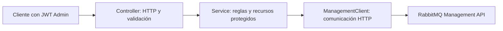

# Paso 15: CRUD de Rabbit Admin con servicio y validación

Cuarta etapa de adaptación a la EP3: administrar colas, exchanges y bindings desde una API propia de AndesStay, con permisos y reglas de operación.

## 1. Qué cambia y por qué

Rabbit Admin tenía dos consultas directas a RabbitMQ. Su endpoint de estado respondía conectado aunque la cola configurada no existiera.

Ahora hay cuatro responsabilidades:



El controlador recibe solicitudes y responde con los códigos HTTP correspondientes. El servicio decide qué se puede modificar y coordina las operaciones. El cliente encapsula la comunicación con RabbitMQ y evita devolver sus credenciales o detalles internos en los errores.

Se usa la [API de administración de RabbitMQ 4.1](https://www.rabbitmq.com/docs/4.1/http-api-reference) para listar recursos, consultar sus estadísticas, gestionar políticas y obtener el identificador real de cada binding. AMQP continúa transportando los eventos de reservas.

## 2. Seguridad y alcance

Todos los endpoints de esta API requieren un JWT válido y el rol `Admin`. Se conservan la validación de emisor y audiencia de Microsoft Entra y la aplicación sin sesión de servidor. Huéspedes, recepción y auditoría no pueden usar Rabbit Admin.

La API consulta recursos del vhost configurado, pero solo modifica los que comienzan con `andesstay.ops.`. Este prefijo está en el catálogo compartido `config/rabbit-topology.properties`.

Las colas y exchanges de reservas, huéspedes, DLQ y demostración están protegidos por sus nombres configurados. También se rechazan bindings que conecten recursos operativos con esos recursos protegidos. La respuesta `writable` muestra qué recursos permite modificar esta API. Los bindings con argumentos adicionales se consultan, pero no se modifican.

Esto permite demostrar el CRUD sin borrar la infraestructura que usan las reservas. El usuario RabbitMQ del entorno local conserva sus permisos actuales; esta restricción corresponde a la API de AndesStay, y no restringe las acciones directas de un administrador en RabbitMQ Management.

## 3. Endpoints

Base local: `http://localhost:8091/api/rabbitmq`.

| Recurso | Crear | Consultar | Actualizar | Eliminar |
| --- | --- | --- | --- | --- |
| Colas | `POST /queues` | `GET /queues`, `GET /queues/{name}` | `PUT /queues/{name}` | `DELETE /queues/{name}` |
| Exchanges | `POST /exchanges` | `GET /exchanges`, `GET /exchanges/{name}` | `PUT /exchanges/{name}` | `DELETE /exchanges/{name}` |
| Bindings | `POST /bindings` | `GET /bindings?exchange=...&queue=...`, `GET /bindings/{exchange}/{queue}?routingKey=...` | `PUT /bindings/{exchange}/{queue}?routingKey=...` | `DELETE /bindings/{exchange}/{queue}?routingKey=...` |

`GET /status` comprueba la cola de reservas realmente configurada y devuelve su nombre, conexión, mensajes listos, mensajes sin confirmar y consumidores. Si falta la cola, responde 503.

Se conserva `GET /queue/{name}` como alias de lectura. Su respuesta ahora es JSON estructurado; un recurso inexistente devuelve 404.

Los listados de colas y exchanges usan `page=1&pageSize=25` por defecto. El tamaño permitido es de 1 a 100. La paginación se solicita al broker.

| Resultado | HTTP |
| --- | --- |
| Creación | 201 y cabecera `Location` |
| Consulta o actualización | 200 |
| Eliminación verificada | 204 |
| JSON, nombre, parámetros o límites inválidos | 400 |
| Falta autenticación válida | 401 |
| Falta rol Admin o recurso protegido | 403 |
| Recurso inexistente | 404 |
| Duplicado, definición incompatible o recurso en uso | 409 |
| Broker inaccesible, credenciales internas incorrectas o topología principal ausente | 503 |

Los errores de negocio tienen `code`, `message` y `details`; no incluyen respuestas internas del broker ni stack traces.

## 4. Cómo funciona cada actualización

**Colas:** siempre se crean durables, de tipo classic y sin borrado automático. Sus ajustes son TTL de mensajes, límite de cantidad y DLX opcional. La actualización sustituye una política propia que coincide únicamente con el nombre exacto de la cola.

Se utilizan [políticas de RabbitMQ](https://www.rabbitmq.com/docs/policies) porque permiten cambiar esos ajustes en una cola existente. La API no cambia su tipo ni la recrea. Reducir el TTL o el límite puede provocar caducidad o desbordamiento de mensajes; son efectos de esos ajustes.

**Exchanges:** se crean durables de tipo `direct`, `fanout` o `topic`. La actualización agrega o retira un exchange alternativo operativo mediante una política. Ese destino recibe mensajes que no se pueden enrutar por los bindings del exchange principal; consulta la [documentación de alternate exchanges](https://www.rabbitmq.com/docs/4.1/ae). El tipo del exchange existente no se cambia.

**Bindings:** actualizar la routing key requiere crear la ruta nueva y quitar la anterior. Se crea primero la nueva para mantener una ruta durante el cambio. Se utiliza `properties_key`, devuelto por RabbitMQ, para eliminar el binding correcto; no se inventa ese identificador a partir de la routing key.

Si falla la eliminación anterior, se intenta retirar únicamente el binding que acaba de crearse. Una ruta que ya existía se conserva. Estas llamadas al broker no forman una transacción conjunta: mientras se actualiza pueden coexistir las dos rutas, y un fallo de compensación requiere revisar los recursos. Las verificaciones de duplicados tampoco sustituyen una coordinación entre administradores concurrentes.

## 5. Validación y borrado

- Nombres: minúsculas, números, puntos, guiones y guiones bajos; máximo 128 caracteres.
- Routing keys: letras, números, puntos, guiones, guiones bajos y comodines `*`/`#`; máximo 128. La clave vacía sirve para fanout.
- TTL: entre 1.000 y 604.800.000 milisegundos.
- Límite de mensajes: entre 1 y 100.000.
- Referencias de DLX y exchange alternativo: deben existir y ser operativas. Un exchange no puede ser su propio alternativo.
- Se rechazan campos JSON desconocidos, decimales para ajustes enteros y campos obligatorios ausentes.

El borrado de cola solicita al broker `if-empty=true` e `if-unused=true`: exige que no haya mensajes ni consumidores. El de exchange usa `if-unused=true` y rechaza referencias desde políticas operativas. Se vuelve a consultar para comprobar que el recurso desapareció antes de responder 204.

Solo después de una eliminación correcta se retira su política propia. No se purgan colas desde esta API.

## 6. Cómo probarlo

Desde la raíz, con Docker Desktop y el entorno local iniciado:

```powershell
.\scripts\test-rabbit-admin.cmd
```

Este script lee las credenciales de `.env` sin imprimirlas. Arranca una instancia de prueba de Rabbit Admin en un puerto aleatorio, con un decodificador JWT simulado exclusivo de las pruebas, y usa RabbitMQ real en localhost. Los tokens de prueba no sirven para la aplicación instalada.

Crea recursos únicos `andesstay.ops.verify.<id>.*`, ejecuta el CRUD, prueba permisos, políticas y entrega, y elimina sus recursos al finalizar. No necesita importar el respaldo SQL ni detener el backend.

Para las pruebas normales sin broker:

```powershell
Set-Location '.\AndesStayRabbitAdmin'
.\mvnw.cmd clean test
```

También se incluyen en `scripts/test-local.cmd`. La prueba real se omite salvo que se habilite con el script específico.

## 7. Ejemplo manual con Postman o PowerShell

Usa un **token de acceso vigente emitido por Microsoft Entra para la API de AndesStay**, con el rol `Admin`. En Postman selecciona Bearer Token. No uses un ID token.

En PowerShell, asigna el token a `$token` en tu sesión; no lo guardes en el repositorio.

```powershell
$base = 'http://localhost:8091/api/rabbitmq'
$headers = @{ Authorization = "Bearer $token" }

# 1. Crear un exchange de operaciones.
$exchange = @{ name = 'andesstay.ops.training.topic'; type = 'topic' } | ConvertTo-Json
Invoke-RestMethod -Method Post -Uri "$base/exchanges" -Headers $headers -ContentType 'application/json' -Body $exchange

# 2. Crear una cola con retención y límite.
$queue = @{
    name = 'andesstay.ops.training.queue'
    settings = @{ messageTtlMs = 60000; maxLength = 100 }
} | ConvertTo-Json
Invoke-RestMethod -Method Post -Uri "$base/queues" -Headers $headers -ContentType 'application/json' -Body $queue

# 3. Conectar las dos piezas.
$binding = @{
    exchange = 'andesstay.ops.training.topic'
    queue = 'andesstay.ops.training.queue'
    routingKey = 'reservation.#'
} | ConvertTo-Json
Invoke-RestMethod -Method Post -Uri "$base/bindings" -Headers $headers -ContentType 'application/json' -Body $binding

# 4. Consultar y actualizar la cola sin recrearla.
Invoke-RestMethod -Uri "$base/queues/andesstay.ops.training.queue" -Headers $headers
$settings = @{ messageTtlMs = 120000; maxLength = 200 } | ConvertTo-Json
Invoke-RestMethod -Method Put -Uri "$base/queues/andesstay.ops.training.queue" -Headers $headers -ContentType 'application/json' -Body $settings

# 5. Cambiar la routing key; # debe viajar codificado en una URL.
$bindingUrl = "$base/bindings/andesstay.ops.training.topic/andesstay.ops.training.queue"
$newKey = @{ routingKey = 'booking.*' } | ConvertTo-Json
Invoke-RestMethod -Method Put -Uri "${bindingUrl}?routingKey=reservation.%23" -Headers $headers -ContentType 'application/json' -Body $newKey

# 6. Quitar binding, cola vacía y exchange sin bindings.
Invoke-RestMethod -Method Delete -Uri "${bindingUrl}?routingKey=booking.*" -Headers $headers
Invoke-RestMethod -Method Delete -Uri "$base/queues/andesstay.ops.training.queue" -Headers $headers
Invoke-RestMethod -Method Delete -Uri "$base/exchanges/andesstay.ops.training.topic" -Headers $headers
```

Puedes observar estos recursos en RabbitMQ Management, Exchanges y Queues. Para demostrar envío manual, publica un mensaje de prueba en el exchange operativo usando la clave `reservation.created` antes del cambio o `booking.created` después. Si deja mensajes pendientes, consume exclusivamente los de esa cola operativa antes de borrarla.

## 8. Configuración y ejecución

`RabbitManagementConfig` configura autenticación básica interna con las credenciales RabbitMQ existentes, el vhost y tiempos de conexión/lectura de cinco segundos. La autenticación de los clientes sigue siendo JWT.

```properties
andesstay.rabbitmq.admin-resource-prefix=andesstay.ops.
andesstay.rabbitmq.management-connect-timeout-ms=5000
andesstay.rabbitmq.management-read-timeout-ms=5000
```

La URL interna se obtiene de `RABBITMQ_MANAGEMENT_URL` o de `http://<RABBITMQ_HOST>:15672`. El vhost se obtiene de `RABBITMQ_VHOST`, por defecto `/`. El cliente codifica el vhost y los identificadores como segmentos de URL.

Rabbit Admin continúa en el perfil opcional `operations`. Para construir y arrancar el servicio:

```powershell
.\scripts\export-rabbit-topology.cmd
docker compose --env-file .env -f docker/docker-compose.yml --profile operations up --build -d --wait rabbit-admin
```

Cuando cambia el catálogo compartido, también debe reconstruirse el backend para que ambos empaqueten la misma versión.

## 9. Evidencias y continuación

Verificación del 8 de octubre de 2026:

| Comprobación | Resultado |
| --- | --- |
| Rabbit Admin, compilación limpia y suite normal | 51 aprobadas; 1 prueba externa omitida |
| Rabbit Admin con RabbitMQ real | Recorrido completo aprobado: CRUD, 401/403, validación, conflictos, políticas, cambio de ruta, DLX con NACK y x-death, exchange alternativo y limpieza |
| Contrato de topología del backend | 2 aprobadas |
| Generador de políticas | 3 escenarios correctos |
| Imágenes y arranque local | Backend y Rabbit Admin reconstruidos; 7 servicios saludables |
| JAR instalados | Clases nuevas presentes; catálogo idéntico al archivo fuente en ambos servicios |
| Colas de trabajo | 1 consumidor por cola; 0 mensajes listos y 0 sin confirmar |
| DLQ real y demostración | 0 consumidores; 0 mensajes |
| Limpieza | Sin colas, exchanges ni políticas de la prueba; se conservan las dos políticas principales |
| HTTP | Dashboard y salud 200; estado y listado Rabbit Admin 401 sin JWT |

La prueba espera que las estadísticas de RabbitMQ reflejen las políticas nuevas antes de verificar sus valores. La primera ejecución detectó que ese campo puede aparecer todavía nulo; se corrigió la espera de la prueba y el recorrido completo pasó, incluido el rechazo real hacia el DLX operativo con cabecera `x-death`.

Logs: `.validation/step-17-admin-tests.log`, `.validation/rabbit-admin-real-tests.log`, `.validation/step-17-backend-topology-tests.log`, `.validation/step-17-docker-build.log` y `.validation/step-17-docker-start.log`. El resumen de servicios, JAR, métricas y HTTP está en `.validation/step-17-runtime-verification.json`. El respaldo previo está en `backup/code-step-17-rabbit-admin-crud/`, excluido de Git.

Esta etapa incorpora el CRUD de Rabbit Admin, su servicio y la validación. La API está preparada para probarse con Postman; todavía no tiene una pantalla propia en el frontend.

Siguen pendientes el microservicio independiente de notificaciones y la base de datos en la nube, además de revisar las evidencias finales de la rúbrica al integrar esas etapas.
