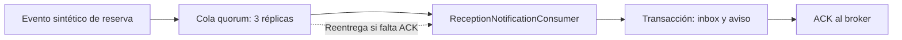

# Paso 20: cluster RabbitMQ y recuperación en local

## Qué incorporamos

Un laboratorio local reproducible con tres nodos RabbitMQ y una cola de reservas
de tipo **quorum**, con tres réplicas. Ejecuta el consumidor de recepción real
de AndesStay con sus servicios de avisos, inbox, transacciones y ACK manual.
La persistencia de negocio de esta prueba usa H2, independiente de MySQL.

Sirve para comprobar lo estudiado sobre recuperación: caída del líder, elección
de otro líder, reconexión del cliente, reentrega y pérdida de mayoría. La
aplicación habitual sigue usando su broker local de un nodo; el laboratorio se
ejecuta en su propio proyecto Docker y usa exclusivamente eventos sintéticos.

## Por qué tres nodos y colas quorum

Un cluster agrupa brokers. La réplica del contenido depende del tipo de cola.
Una cola quorum mantiene réplicas y necesita una mayoría disponible: con tres
réplicas, dos forman mayoría. Puede continuar cuando cae una; con una sola
disponible no puede confirmar publicaciones con seguridad.

Cada cola quorum tiene un líder, que coordina su contenido. Al perderlo, las
réplicas restantes pueden elegir otro. La prueba consulta al broker qué nodo
es líder y comprueba el cambio, en lugar de asumirlo. Véanse las
[colas quorum de RabbitMQ 4.1](https://www.rabbitmq.com/docs/4.1/quorum-queues).

Los nodos tienen nombres estables `rabbit@rabbit1`, `rabbit@rabbit2` y
`rabbit@rabbit3`, una cookie Erlang compartida generada para cada ejecución y
volúmenes independientes. Se agrupan mediante descubrimiento automático
`classic_config`, usando `rabbit1` como nodo inicial. Los miembros que reinician
conservan su identidad y vuelven a contactar con sus pares; no se resetean ni se
eliminan para simular una caída. Véase la
[formación de clusters](https://www.rabbitmq.com/docs/4.1/cluster-formation).

## Cómo se relaciona con AndesStay



El consumidor primero confirma la transacción que guarda el ID del evento y su
aviso. Después envía el ACK. Si la conexión falla entre ambos pasos, RabbitMQ
puede entregar el mismo evento nuevamente. `InboxService` reconoce el mismo ID
y evita ejecutar otra vez la creación del aviso, aunque confirme la reentrega.

Esto combina entrega repetible con un efecto de negocio deduplicado. La prueba
demuestra esa combinación con RabbitMQ real y los servicios reales de recepción.
Los IDs positivos de reserva y unidad son datos sintéticos; no crea reservas
en la aplicación, no usa sus cuentas y no cambia los JWT ni los permisos.

## Qué comprueba la prueba

| Etapa | Comprobación |
|---|---|
| Arranque | Tres nodos pertenecen al mismo cluster y la cola tiene tres réplicas online |
| Publicación inicial | Diez eventos persistentes reciben publisher confirms |
| Fallo después del commit | Se obtiene una entrega sin ACK y el consumidor guarda su aviso; justo antes del ACK se mata el contenedor del líder |
| Elección y reconexión | El líder cambia, quedan dos réplicas online y la conexión Spring se establece en otro nodo de su lista de direcciones |
| Trabajo durante la caída | Diez eventos adicionales reciben confirms con dos nodos disponibles |
| Reentrega | El evento inicial vuelve con `redelivered=true`; los veinte IDs se procesan y hay veinte avisos y veinte registros inbox |
| Reincorporación | El nodo detenido vuelve a iniciar con su volumen y las tres réplicas aparecen online |
| Pérdida de mayoría | Se detienen dos nodos; una publicación no recibe confirmación durante los dos segundos comprobados |
| Recuperación | Vuelven los nodos y se reenvía el mismo ID de la publicación incierta; quedan veintiún avisos y veintiún registros inbox, y la cola se vacía |
| Limpieza | Se eliminan exclusivamente contenedores, red y volúmenes del proyecto de prueba |

La caída usa `docker kill` sobre el contenedor real. Antes de controlarlo, el test
verifica su ID y sus etiquetas de proyecto y servicio. Un adaptador del canal
intercala esa caída antes del ACK y delega en el canal AMQP real: el error de ACK
procede de la conexión cerrada. El efecto de negocio no se simula.

La conexión Spring incluye las tres direcciones y se comprueba que cambia de
puerto al perder el nodo original. Es necesario combinar réplicas de la cola
con una lista de nodos accesibles para el cliente.

**Una publicación sin confirmación tiene resultado incierto.** El timeout no
demuestra que el broker haya descartado el mensaje. Tras recuperar la mayoría
puede aparecer su confirmación o su entrega. Por eso la prueba reenvía el mismo
ID y comprueba un único efecto; no crea un evento con un ID diferente para cada
intento.

## Archivos y decisiones

| Archivo | Responsabilidad |
|---|---|
| `docker/tests/rabbit-cluster/docker-compose.yml` | Tres nodos, volúmenes, puertos aleatorios de localhost y límites de recursos |
| `docker/tests/rabbit-cluster/rabbitmq.conf` | Descubrimiento, nombre del cluster y configuración del laboratorio |
| `docker/tests/compose.env` | Archivo de entorno vacío para impedir la carga automática del `.env` de la aplicación; compartido con la prueba del gateway |
| `scripts/test-rabbit-cluster.cmd` y `.ps1` | Entrada para Windows y comprobación de herramientas |
| `scripts/test-rabbit-cluster.mjs` | Credenciales aleatorias, arranque, puertos, ejecución, evidencia y limpieza |
| `scripts/invoke-rabbit-cluster-tests.ps1` | Ejecución de Maven y registro de su salida |
| `RabbitClusterRecoveryTests.java` | Escenario con AMQP real, transacciones H2 y consumidor de recepción |

La imagen es RabbitMQ 4.1.8 Management, fijada por digest. Cada nodo tiene un
límite de 512 MB y una CPU; se limita también el número de schedulers Erlang.
Los tres límites suman 1,5 GB de memoria de contenedores, además de Java y Docker.
La cookie y la contraseña se generan en memoria, se pasan al proceso de prueba
y no se guardan en el repositorio ni se imprimen.

La cola y el exchange usan un prefijo aleatorio `andesstay.cluster-test.*`.
La routing key se obtiene del catálogo compartido de AndesStay. La cola se
declara explícitamente como quorum después de confirmar que los tres nodos
están disponibles.

La prueba Java se activa solo con `TEST_RABBITMQ_CLUSTER=true` y los parámetros
creados por el script. En una ejecución normal de `test-local.cmd` se omite;
esa ejecución no necesita iniciar el cluster.

## Cómo ejecutarlo

Necesitas Docker Desktop con el motor Linux iniciado, Node 24 y JDK 17 en PATH.
Maven se obtiene mediante el wrapper del backend. Desde la raíz del repositorio:

```powershell
.\scripts\test-rabbit-cluster.cmd
```

Puede ejecutarse mientras AndesStay sigue abierto en `http://localhost:5173`.
Usa puertos aleatorios exclusivamente en `127.0.0.1`, una red propia y un nombre
de proyecto `andesstay-cluster-test-xxxxxxxx`. La primera ejecución puede
descargar la imagen y dependencias de Maven. El arranque tiene espera acotada y
el comando de Maven tiene un máximo de cinco minutos.

Al terminar correctamente verás una línea similar a:

```text
Cluster verificado: 21 eventos, 21 avisos, sin duplicados. Tres nodos y volumenes temporales eliminados.
```

Puedes leer el resultado compartible con:

```powershell
Get-Content .ecc/evidence/rabbitmq-cluster-latest.json
```

La evidencia registra réplicas, líder anterior y nuevo, tiempo observado,
reconexión, reentrega, pérdida y recuperación de mayoría, recuentos y limpieza.
Los detalles locales quedan en `.validation/rabbit-cluster-tests.log` y
`.validation/rabbitmq-cluster-latest.json`.

La limpieza también se intenta ante un fallo. Antes de borrar volúmenes,
verifica que pertenecen al proyecto aleatorio de esta ejecución y tengan su
prefijo. Después comprueba que no quedan contenedores, red ni volúmenes de ese
proyecto. Si Docker impide la limpieza, el script informa su nombre exacto y
termina con error.

## Alcance y próximos pasos

Este laboratorio comprueba la caída de procesos en una sola máquina. Los tres
contenedores dependen del mismo PC y motor Docker. La prueba no cubre una caída
del PC, particiones de red, sustitución permanente de discos ni una instalación
distribuida entre máquinas.

La persistencia de negocio se verifica con H2. Las pruebas anteriores con MySQL
real siguen siendo la evidencia específica de ese motor. El backend habitual
conserva las colas y la conexión configuradas en su entorno local de un nodo.
Una adopción del cluster por la aplicación requiere planificar la migración de
colas existentes y las direcciones de conexión, conservando sus datos.

El siguiente paso recomendado es reunir la matriz de evidencias de EP3 y revisar
los recorridos por rol y el registro externo. La conexión a una base de datos
en la nube sigue pendiente como requisito de la rúbrica; su proveedor se decide
por separado. El respaldo previo está en `backup/code-step-22-rabbit-cluster/`,
excluido de Git.

## Verificación del 13 de octubre de 2026

La prueba con el cluster real pasó sin fallos ni errores. La cola tuvo tres
réplicas; su líder cambió de `rabbit@rabbit1` a `rabbit@rabbit3`. Se observaron
1614 ms entre la provocación de la caída y la lectura del nuevo líder; ese tiempo
incluye comandos Docker y consultas de comprobación y no es un benchmark.

Se comprobaron reconexión, reentrega del evento ya confirmado en H2, veinte
avisos tras la primera recuperación, ausencia de confirmación sin mayoría y
recuperación final con **21 eventos únicos, 21 avisos y 21 registros inbox**.
Los tres contenedores, su red y sus tres volúmenes temporales se eliminaron.

El primer intento identificó un problema de quoting de las etiquetas Docker
desde Java en Windows. Se corrigió usando la salida JSON de las etiquetas y
se repitió el escenario completo correctamente. El comando de limpieza también
se verificó durante ese fallo.

La suite normal del backend pasó con 245 pruebas aprobadas y seis externas
omitidas, incluida esta nueva prueba de cluster. Se verificó la compilación de
las pruebas y el rechazo de errores de formato en el diff. La prueba del gateway
se repitió después de usar el archivo de entorno vacío: sus seis escenarios
pasaron y 78 de 100 solicitudes de la ráfaga se rechazaron antes del BFF de prueba.

El entorno habitual conserva sus contenedores y sus seis servicios están
saludables. En HTTP real, login respondió 200 y las reservas por v1 y por el alias
respondieron 401 sin JWT. No se reconstruyeron sus imágenes ni se crearon
reservas. La comprobación está en `.validation/step-22-runtime-verification.json`
y el log normal del backend en `.validation/step-22-backend-tests.log`.
